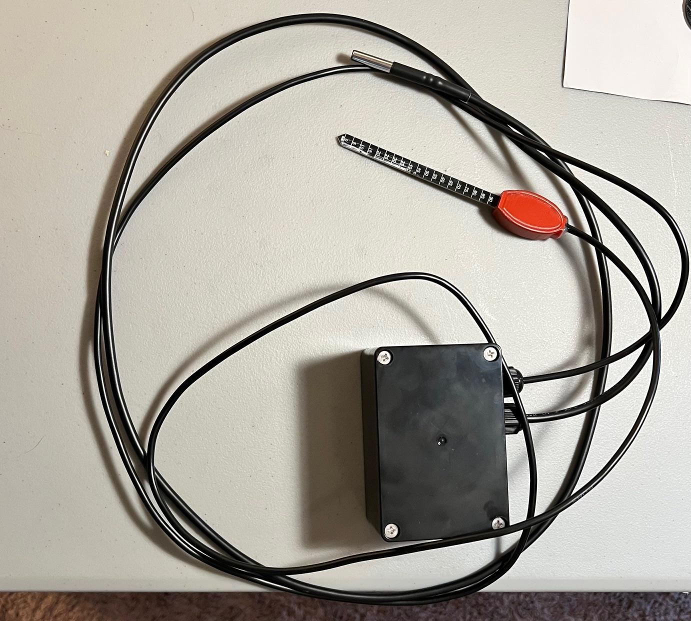
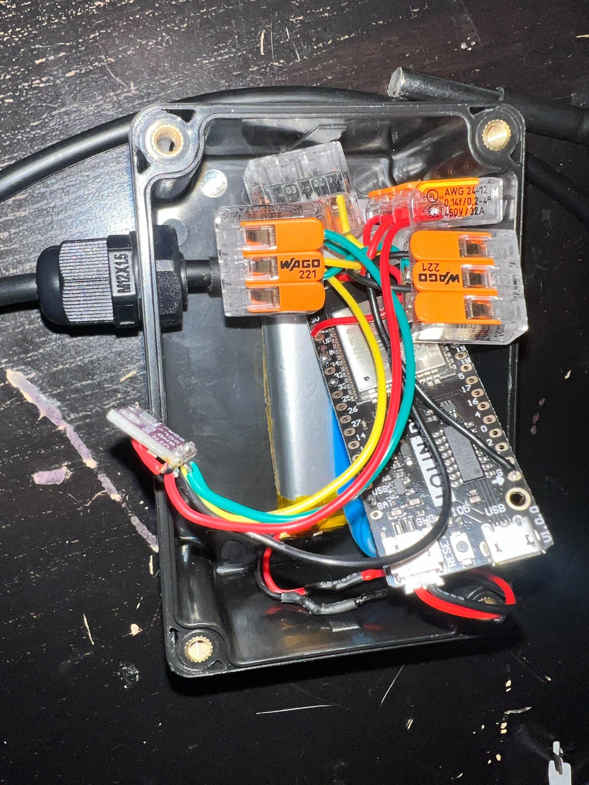

# Build Photos

Reference photos of the soil moisture node described in the
[main README](../README.md). Two batches: the `12xx` files show the probe
and the open enclosure during assembly, and the `IMG_13xx` files show the
finished unit.

## Finished unit

| Photo | What it shows |
|-------|---------------|
| [IMG_1339.jpeg](IMG_1339.jpeg) | The complete node laid out: sealed black enclosure, the stainless SHT31 garden probe on its cable, and the VH400 soil probe with its red cover and depth-marked blade. |
| [IMG_1340.jpeg](IMG_1340.jpeg) | Same unit from the other side, showing both cable glands where the two sensor cables enter the enclosure. |
| [IMG_1341.jpeg](IMG_1341.jpeg) | Close-up of the enclosure lid and the two cable glands. The lid is held by four screws. |
| [IMG_1342.jpeg](IMG_1342.jpeg) | The VH400 blade with its 0 to 90 mm depth scale next to the stainless SHT31 probe tip. |

## Garden temperature and humidity probe

The garden SHT31 (I2C address `0x44`) is the corrosion-resistant stainless
sleeved probe listed in the [Parts](../Parts) folder.

| Photo | What it shows |
|-------|---------------|
| [1285.jpeg](1285.jpeg) | End-on view of the stainless probe tip showing the sealed sensing face. |
| [1286.jpeg](1286.jpeg) | Side view of the probe tip and the heat-shrink strain relief where the cable enters the sleeve. |
| [1290.jpg](1290.jpg) | Macro shot of the probe tip through a loupe, showing the potting at the end of the sleeve. |

## Inside the enclosure

| Photo | What it shows |
|-------|---------------|
| [1287.jpg](1287.jpg) | Open enclosure, top down. LOLIN D32 ESP32 board, LiPo battery wrapped in Kapton tape, WAGO 221 lever connectors for the sensor wiring, an M12x1.5 cable gland, and the small purple SHT3x breakout that serves as the enclosure sensor. |
| [1288.jpg](1288.jpg) | Angled view of the LOLIN D32 with its JST battery lead plugged in, the battery underneath, and the enclosure sensor wiring. |
| [1289.jpg](1289.jpg) | Close-up of the enclosure SHT3x breakout (VIN, GND, SCL, SDA) and the WAGO connectors that fan out the I2C and power lines to both SHT31 sensors. |

## Wiring colour convention

Visible in the enclosure photos:

- Red: sensor V+ (battery positive)
- Black: sensor ground, switched through the MOSFET
- Green and yellow: the two I2C lines (SDA on GPIO21, SCL on GPIO22)

See the wiring diagram in the [main README](../README.md#wiring-diagram)
for the full pinout.
